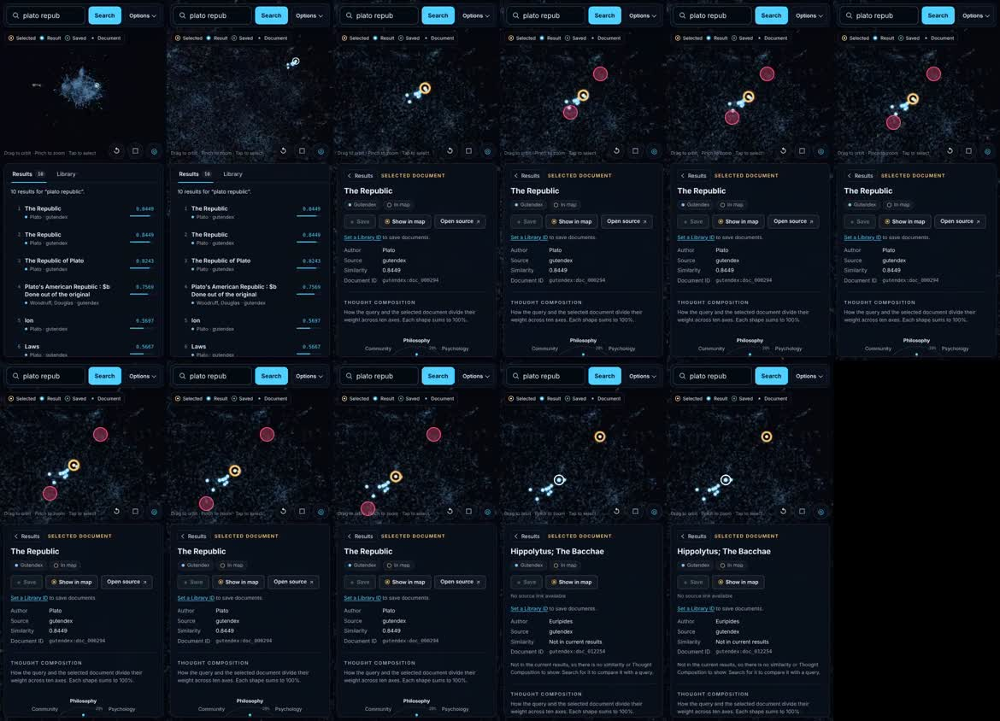
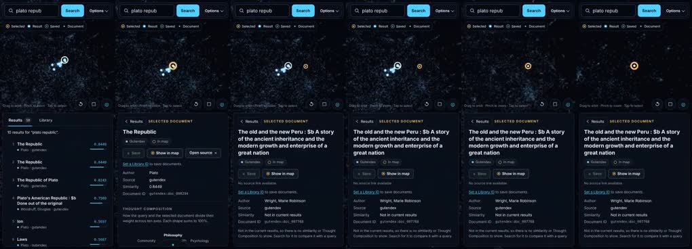
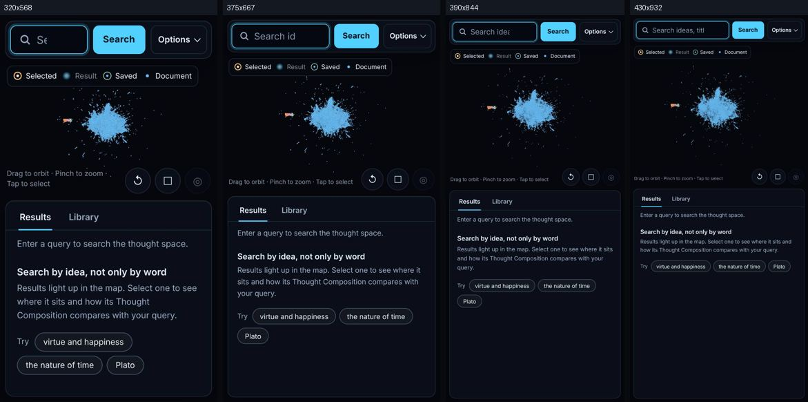
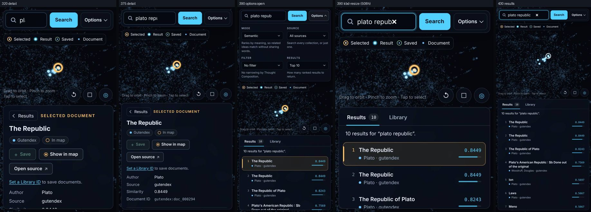
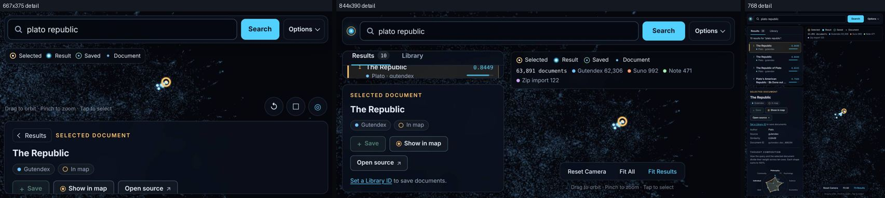
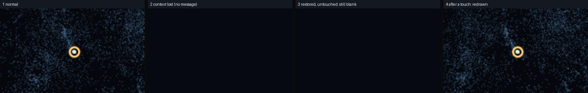

# ThoughtMap スマートフォン UX 監査（2026-10-31）

対象: `10_ThoughtMap/threejs/`（main @ `1cddf83`、PR #8 マージ後）
目的: スマートフォンの小さな画面とタッチ操作で、思考空間を快適に探索できるかを評価する。

> **重要:** この監査はすべて **Chromium のモバイルエミュレーション**（Playwright、SwiftShader によるソフトウェア WebGL）で行った。
> **iOS Safari・Android Chrome の実機では一切検証していない。** 実機でしか分からない項目は「[実機未検証事項](#7-実機未検証事項)」にまとめた。
> 地図データは実データ（`map_projection_3d.json`、63,891 文書）。検索結果はローカルの fixture API（タイトル・著者のキーワード一致）による。実検索エンジンには接続していない。

---

## 1. 検証方法

| 項目 | 方法 |
| --- | --- |
| 画面サイズ | 320×568、375×667、390×844、430×932、768×1024（縦）、667×375・844×390（横）。`isMobile` / `hasTouch` 有効、`deviceScaleFactor` 2 |
| タップ | Playwright の touchscreen。本物の `pointerType: "touch"` イベントが発生する |
| 2 本指操作 | Chrome DevTools Protocol `Input.dispatchTouchEvent`。指ごとに別の `pointerId` を持つ本物のマルチタッチ。キャンバス上の pointer イベントの順序をログに記録して確認した |
| 計測 | 画面サイズごとに、表示領域の大きさ・横はみ出し・全タッチ対象の寸法・レーダーの位置を自動計測した（[`data/layout.json`](data/layout.json)） |
| 長時間操作 | JS ヒープ（GC 後に計測）、ジェスチャー中の描画回数、回転時の中心ずれ、凍結→復帰、WebGL コンテキスト喪失→復元 |
| 再現テスト | [`tests/mobileTouch.test.ts`](../../threejs/tests/mobileTouch.test.ts) |

---

## 2. 問題一覧

| ID | 重大度 | 問題 | 根拠 |
| --- | --- | --- | --- |
| **M-01** | **Critical** | 2 本指操作の終わりに指を離すと、その離した動作が**タップ扱い**になる。選択文書が別の文書に替わるか選択が解除され、詳細シートが結果一覧に戻る | 実ブラウザで再現（動画あり）。ユニットテストでも 2 通りの離し順で再現 |
| **M-02** | High | 指が 5 px 以上ぶれたタップを**無視**する。代わりにカメラがわずかに回転する | 7 px のぶれで選択されなかった |
| **M-03** | High | 対象から少し外れたタップで、読んでいた文書が**別の文書に替わるか選択が解除**され、シートが一覧に戻る。元に戻す手段がない | 実ブラウザで再現（動画あり） |
| **M-04** | High | 全体表示では、タップの判定半径 24 px の中にノードが**24,421 件**入る。狙った文書は選べない | 390 px 幅の画面中央で計測 |
| **M-05** | High | 縦向きのスマートフォンで 3D マップが**画面の 32〜35 %** しかない（高さ 192〜338 px）。さらに凡例（約 30 px）と操作ボタン・ヒント（約 50 px）がマップに重なる | 計測値 |
| **M-06** | High（実機で要確認） | 検索を実行しても検索欄のフォーカスが残る。実機ではキーボードが閉じず、結果シートを隠す可能性が高い | 全画面幅でフォーカスが残ることを確認 |
| **M-07** | Medium | 横向きのスマートフォン。667×375 ではマップの高さが 140 px、シートが 147 px しかない。844×390 ではタブレット用レイアウトになり、結果一覧が約 1 行に潰れる | スクリーンショット |
| **M-08** | Medium | レーダーが詳細シートの画面外にある。390 px 幅ではレーダーと凡例を見るのに 265 px のスクロールが必要。320・375 px 幅では最初の画面に全く入らない | 計測値 |
| **M-09** | Medium | 文書を比較しにくい。3 件を見るのに 5 タップかかり、そのたびにレーダーまでスクロールが要る。次・前の結果へ移る操作がない | 計測値 |
| **M-10** | Medium | WebGL コンテキストを失うとマップが**黒くなり、メッセージも出ない**。コンテキストが復元されても**触るまで再描画されない** | 再現画像あり |
| **M-11** | Medium | タッチ対象が推奨の 44 px に届かない。カメラボタン 38、戻る 28（高さ）、保存などの操作ボタン 32、例のチップ 28、タブ 36〜38 | 計測値 |
| **M-12** | Medium | Options を開くと上部バーが 298 px に広がり、マップが画面の 23 % まで縮む | 計測値 |
| **M-13** | Medium | 320 px 幅では検索欄が 114 px しかなく、入力した文字が 2〜3 文字しか見えない | スクリーンショット |
| **M-14** | Medium | カメラが移動している最中のタップは、指が着くまでに目標が動くため、別のノードを選ぶ | 200 ms 間隔の連続タップで再現 |
| M-15 | Low | 押した瞬間の反応がない（指を離してから選択表示とシートが変わる）。地図アプリに慣れた人が期待するダブルタップでの拡大もない | 確認 |
| M-16 | Low | 操作説明は 10.5 px のヒント 1 行だけで、初めての人には弱い | 確認 |
| M-17 | Low | 一覧に戻るとスクロール位置は保たれる（600→589 px）が、選択した行が画面内に入る保証はない | 計測値 |
| M-18 | Low（実機で要確認） | 読み込み時に検索欄へ自動でフォーカスする。一部の Android ブラウザではキーボードが勝手に開く可能性がある | コード上で確認 |

**問題なしと確認できたもの（エミュレーション）**
- 1 本指での回転、ピンチでの拡大・縮小（12→3.7）、2 本指での移動。
- Reset と Fit Results。
- 表示中の結果ノードをタップすると選択できる。
- 画面を回転しても選択した文書が表示領域の中心に残る（ずれ 0 px）。
- ページを凍結→復帰した後もタップできる（比較用の確認と一致）。
- JS ヒープは 20 回の操作後も 21.2→21.4 MB で、増加傾向はない。
- どの画面幅でも横方向のはみ出しはない。

---

## 3. 再現手順とスクリーンショット

### M-01（Critical）: 2 本指操作のあと、指を離すとタップ扱いになる

**原因:** `ThoughtMapInteractionController` は、最後に画面に触れた指 1 本しか追跡していない（`pointerId` を上書きする）。さらに `pointerup` が、離された指がどれかを確認していない。そのため、後から置いた指が動かないままのピンチでは、どちらの指を離してもタップとして処理され、`pick` → `select` / `clear` が実行される。

**再現手順（390×844）**
1. 結果を 1 件選び、詳細シートを表示する。
2. マップ上に指 A を置く。続けて指 B を置き、**指 B は動かさない**。
3. 指 A だけ動かしてピンチする（拡大・縮小は効く）。
4. どちらかの指を離す。

→ 選択している文書が別の文書に替わるか選択が解除され、詳細シートが結果一覧に戻る。後から置いた指 B を動かした場合は起きない。どの指を動かしたかで結果が変わる。

動画: [media/m01-pinch-release-changes-document.mp4](media/m01-pinch-release-changes-document.mp4)（ピンク色の円が指）

**回帰テスト**（[`tests/mobileTouch.test.ts`](../../threejs/tests/mobileTouch.test.ts)）
- 監査時は 2 通りの離し順を `it.fails`（不具合の記録）として置いた。修正後は通常のテストに変えた。
- M-02・M-03・M-14 と、マウス操作が変わらないことの確認を加え、全 15 件にした。
- 修正前のコードでは、タッチの不具合に当たる 7 件が失敗し、マウスと比較用のケースは成功することを確認済み。

**修正後**: 動画 [media/m01-fixed-pinch-release-keeps-document.mp4](media/m01-fixed-pinch-release-keeps-document.mp4)。同じ操作をしても文書が保たれる。

### M-03（High）: 対象から外れたタップで、読んでいた文書が置き換わる

動画: [media/m03-off-target-tap-replaces-document.mp4](media/m03-off-target-tap-replaces-document.mp4)
- 結果の集まりから少しずれた場所をタップすると、判定半径内にあった背景の無関係な文書に選択が替わる。
- 本当に何もない場所をタップすると選択が解除され、シートが一覧に戻る（`viewBefore: detail → viewAfter: list`）。

### M-05 / M-13: 画面サイズ別の初期表示

| 画面 | 3D マップ表示領域 | 画面に占める割合 |
| --- | --- | --- |
| 320×568 | 304×192 | 32 % |
| 375×667 | 359×232 | 33 % |
| 390×844 | 374×302 | 34 % |
| 430×932 | 414×338 | 35 % |
| 768×1024 | 425×930 | 50 % |
| 667×375（横） | 651×140 | 36 % |
| 844×390（横） | 470×296 | 42 % |

### M-08 / M-12 / M-06: 詳細表示、Options、キーボード

左から順に以下のとおり。
- 320 px の詳細表示：レーダーが最初の画面に入らない。
- 375 px の詳細表示。
- 390 px で Options を開いた状態：マップは 23 %。
- 390 px でキーボードを表示した状態：Android の「画面サイズを縮める」動作を、高さ 508 px として模擬。
- 430 px の結果一覧。

### M-07: 横向きとタブレット

### M-10: WebGL コンテキストの喪失と復元

`WEBGL_lose_context` で喪失させ、その後復元した。
1. 通常表示。
2. 喪失中：マップが黒く、メッセージが出ない。
3. 復元後、触らない状態：黒いまま。
4. 1 回なぞった後：再描画される。

---

## 4. UX 観点の評価

| 観点 | 評価 | 根拠 |
| --- | --- | --- |
| 初見で操作方法を理解できるか | △ | 1 行のヒントと凡例だけ。検索例のチップは役に立つ。3D 上のタップに起きること（選択・解除・シート切り替え）は予測しにくい |
| 片手で主要操作ができるか | △ | 検索欄と Options は画面上端にあり、片手では届きにくい。結果一覧と詳細は下半分にあるので操作しやすい。回転は片手でできるが、拡大・縮小は 2 本指が必要 |
| ボタンが小さすぎないか | × | 44 px に届くタッチ対象が 1 つもない（M-11） |
| 3D マップの面積は十分か | × | 32〜35 %、横向きでは高さ 140 px（M-05、M-07） |
| 詳細情報が読みやすいか | ○ | タイトル 18 px、本文 12.5〜13.5 px でコントラストは十分。ただしレーダーは画面外（M-08） |
| タップの誤認識 | × | 2 本指操作の後（M-01）、指のぶれ（M-02）、対象外れ（M-03）、移動中（M-14）、密集部（M-04） |
| 操作へのフィードバック | △ | 選択後の金色の照準とシートの切り替えは明確。押した瞬間の反応はない（M-15） |
| 結果一覧と詳細の往復回数 | × | 1 件見るごとに 2 タップとスクロールが要る（M-09） |
| 小さい画面でのレーダーの分かりやすさ | △ | 説明文と凡例は付いたが、320〜390 px では画面外にあり、文字も小さい |
| スクロールと 3D 操作の干渉 | ○ | キャンバスは `touch-action: none` で、シートは独立してスクロールする。干渉は見られなかった |

---

## 5. スマートフォン UI の再設計案の比較

| | 案 A: 上下分割の改善 | **案 B: 可変ボトムシート** | 案 C: 探索モードの切り替え |
| --- | --- | --- | --- |
| 構成 | マップが上、情報が下の現状を維持。凡例を小さくし、ボタンをマップ内に移し、割合を調整する | マップを画面全体の背景にする。検索結果と詳細を 1 枚のシートにまとめ、3 段階で止める（ピーク 約 96 px／半分／全画面）。3D 操作を始めるとピークまで自動で下がる | 「検索・一覧」と「3D 探索」を切り替える。3D 探索中はマップを画面全体で使う |
| 3D マップの面積 | 約 45 % | **55〜88 %**（シートの高さによる） | 探索中 約 90 %、一覧中 0〜30 % |
| 操作手数（検索→選択→レーダー→次の文書） | 現状とほぼ同じ（次の文書へ 2 タップ＋スクロール） | **選択 1 タップ。次の文書は 1 タップまたはスワイプ。レーダーは半分の高さで見える** | モード切り替えの分、1 回ごとに 1 タップ増える |
| 学習コスト | 低い（現状と同じ） | 低〜中（地図アプリで一般的な操作） | 中（今どのモードかを意識する必要がある） |
| 見やすさ | 小さい画面では限界がある | マップと情報を、場面に応じて大きく表示できる | 片方ずつなら最大。同時には見られない |
| 実装の重さ | 小（CSS 中心） | 中（ドラッグして 3 段階で止まるシート、約 300 行と CSS。PC 版には影響しない） | 中（モード状態と切り替え UI） |
| 既存機能への影響 | 小 | 小。既存の `setSafeArea` がシートの高さに合わせて表示領域を自動で測り直すため、**選択ノードは常にシートの上の中央に来る**。一覧と詳細の切り替えは、シートの中身の切り替えにそのまま対応する | 中（一覧と 3D の同時表示をやめる） |

表のうち、案 A〜C の面積と操作手数は**設計上の見込み**で、試作・計測はしていない。現状の値（32〜35 %、1 件あたり 2 タップとスクロール）は計測値。

### 推奨: 案 B を基本に、案 C の「探索中はマップを最大にする」を自動化して組み込む

- **シートの 3 段階**
  - ピーク：検索欄、件数、選択中の文書のタイトル。
  - 半分：結果一覧、または文書の要約と**小さいレーダー**。
  - 全画面：詳細とレーダーの数値表。
- **マップに 1 本でも指が触れたら**、シートは自動でピークまで下がり、地図が画面の約 88 % になる。指を離した後、選択していればシートは半分の高さに戻る。
- **タップの規則**
  - 指が触れた瞬間の対象を選ぶ。
  - 指のぶれは 10 px まで許容する。
  - 2 本指操作は決してタップ扱いしない。
  - 移動中の最初のタップは停止だけにする。
  - 何もない場所のタップでは選択を解除しない（解除は明示的に「×」で行う）。
  - 密集部（判定半径内に一定数以上のノードがある場所）をタップしたら、選択せずにその地点へ拡大する。
- **文書の比較**：詳細に「前へ・次へ」を付け、左右スワイプでも切り替えられるようにする。レーダーは半分の高さで見える位置（詳細の冒頭）に置く。
- **上部**：検索欄だけをマップ上に浮かせる。Options は全画面のシート、またはボトムシートの中で開き、マップを縮めない。
- **タッチ対象**：すべて 44 px 以上。
- **横向き**：シートを右側の幅 360 px のパネルにする（案 B の横向き版）。

---

## 6. 最優先で修正すべき項目

| 順位 | 内容 | 規模 | 状態 |
| --- | --- | --- | --- |
| 1 | **M-01 / M-02**：pointer の追跡を指ごとにし、`pointerup` を照合する。2 本指操作はタップ扱いしない。タッチ時の許容ぶれを 10 px にし、指が触れた瞬間の対象を選ぶ | 1 ファイル | **修正済み**（第 1 段階のタッチ操作修正 PR） |
| 2 | M-03：タッチ操作では、何もない場所のタップで選択を解除しない | 数行 | **修正済み**（同 PR。マウスでは従来どおり解除する） |
| 3 | M-06：タッチ端末では検索実行後に `input.blur()` してキーボードを閉じる | 1 行 | 案のみ（実機で確認が必要） |
| 4 | M-10：`webglcontextlost` で「再読み込み中」と表示し、`webglcontextrestored` で `requestRender()` を呼ぶ | 約 20 行 | 案のみ |
| 5 | M-14：カメラ移動中の最初のタップは停止だけにする | 数行 | **修正済み**（同 PR。マウスでは従来どおり選択する） |
| 6 | M-04 / M-05 / M-07 / M-08 / M-09 / M-11 / M-12 / M-13：案 B で画面構成を作り直す | 中 | 設計案 |

監査時に添付していた修正案のパッチは、第 1 段階の PR で本体に取り込んだため削除した。

---

## 7. 実機未検証事項

以下はエミュレーションでは確かめられない、または確かめていない。

- **iOS Safari・Android Chrome の実機での操作感全般**
  - タッチの遅延。
  - Safari 独自のジェスチャーイベントと OrbitControls の干渉。
  - pointer capture の挙動。
  - 2 本指操作の後に指を離したときの M-01 の現れ方。実装上は実機でも起きる。
- **ソフトウェアキーボード**
  - iOS ではレイアウトは縮まず、見える範囲だけが縮む。
  - `100dvh` の扱い。
  - 検索後にキーボードが閉じるか（M-06）。
  - 入力欄が隠れないか。
- **実 GPU での性能**
  - FPS（エミュレーションでは CPU 描画で 13 fps、実機の参考にはならない）。
  - 発熱、電池の消費。
  - 63,891 点を連続で回転・拡大・縮小したときの遅延。
- **WebGL コンテキスト喪失の頻度**：実機でバックグラウンドへ移ったときやメモリが不足したときに、どれくらい起きるか。M-10 の影響の大きさはこれ次第。
- **ノッチやホームインジケーターとの重なり**：`env(safe-area-inset-*)` を使っていない。Safari の通常表示では問題ないはずだが、ホーム画面に追加したときは要確認。
- **画面回転時の実機での再レイアウト**、**バックグラウンドからの復帰**（エミュレーションでは問題なし）。
- **実検索エンジンでの結果の見え方**：今回は fixture の検索結果を使った。

---

## 付録: データ

- [`data/layout.json`](data/layout.json)：画面サイズごとの寸法、タッチ対象の一覧
- [`data/touch.json`](data/touch.json)：各ジェスチャー前後のカメラ状態と選択状態、pointer イベントのログ
- [`data/browse.json`](data/browse.json)：スクロール位置の保持、レーダーの位置、タップ数、ヒープ、描画回数、回転、コンテキスト喪失
  - このファイル内の「凍結→復帰後のタップ失敗」は、直前の操作手順によって起きた偶発的な結果だった。単独の比較確認（凍結の前後に同じ方法でタップ）では、どちらも正しく選択できた。
